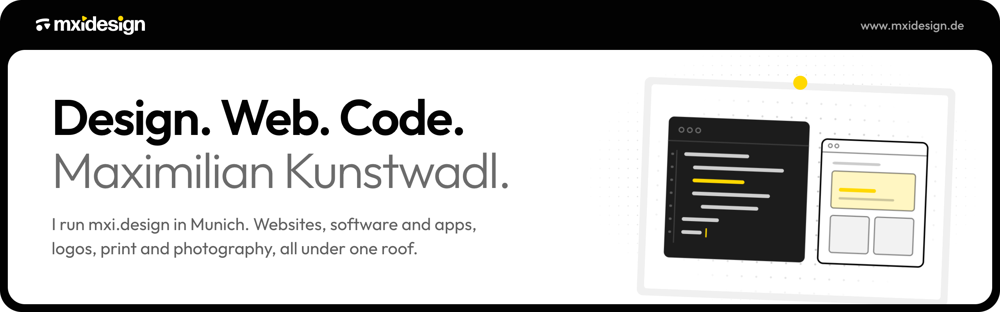
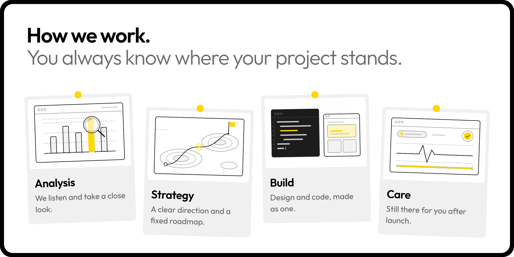
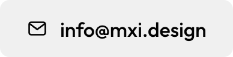
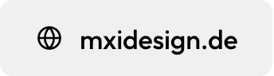
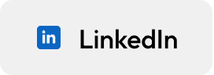

### Hi, I'm Maxi.

With mxi.design in Munich, we design and build websites, software and apps, logos, print and photography for brands that want more. Design and code come from one team, and we stay with you after launch.

Our client work lives in private repositories. If you'd like to talk about your next project, book a call or drop us a line.

 

 

&nbsp;
&nbsp;
&nbsp;

 

Also by me: <a href="https://www.gastique.de">Gastique</a>
