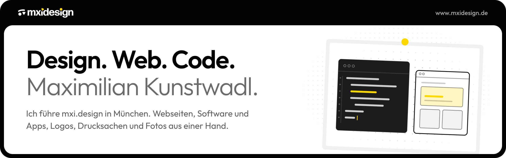
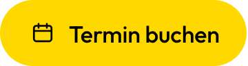

### Hallo, ich bin Maxi.

Mit mxi.design gestalten und bauen wir in München Webseiten, Software und Apps, Logos, Drucksachen und Fotos für Marken, die mehr wollen. Design und Code kommen dabei aus einer Hand, und nach dem Start bleiben wir für dich da.

Unsere Kundenprojekte liegen in privaten Repositories. Wenn du über dein nächstes Projekt sprechen willst, buch dir einfach einen Termin oder schreib uns.

 

 

&nbsp;
&nbsp;
&nbsp;

 

Außerdem von mir: <a href="https://www.gastique.de">Gastique</a>
